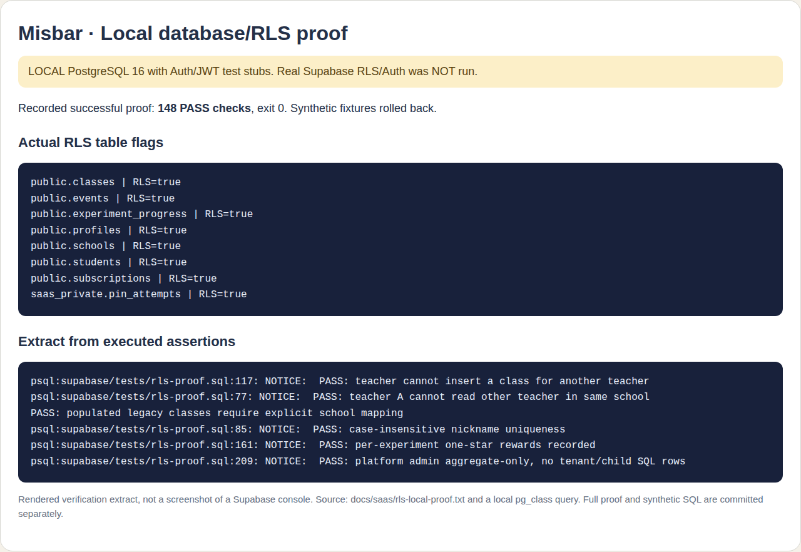
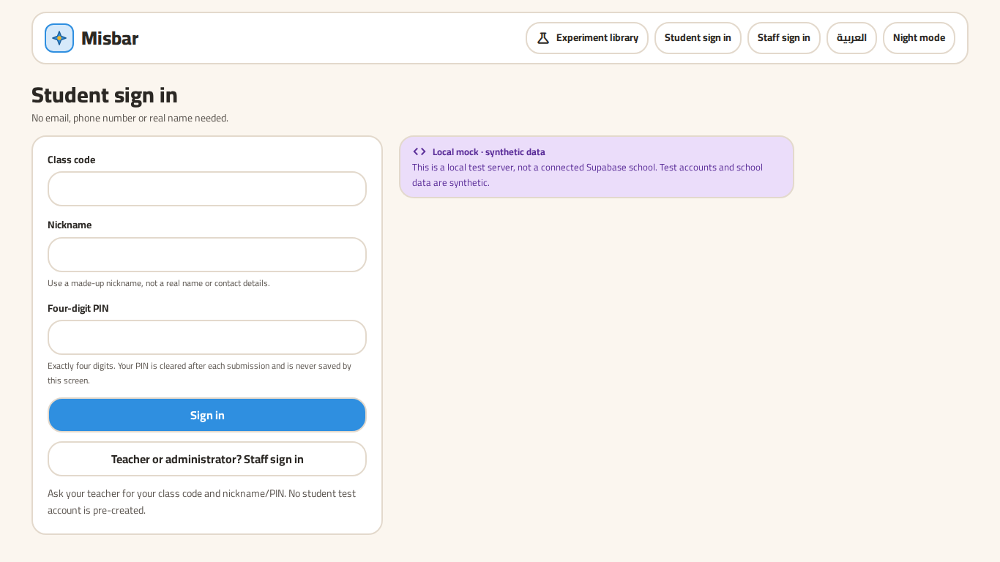
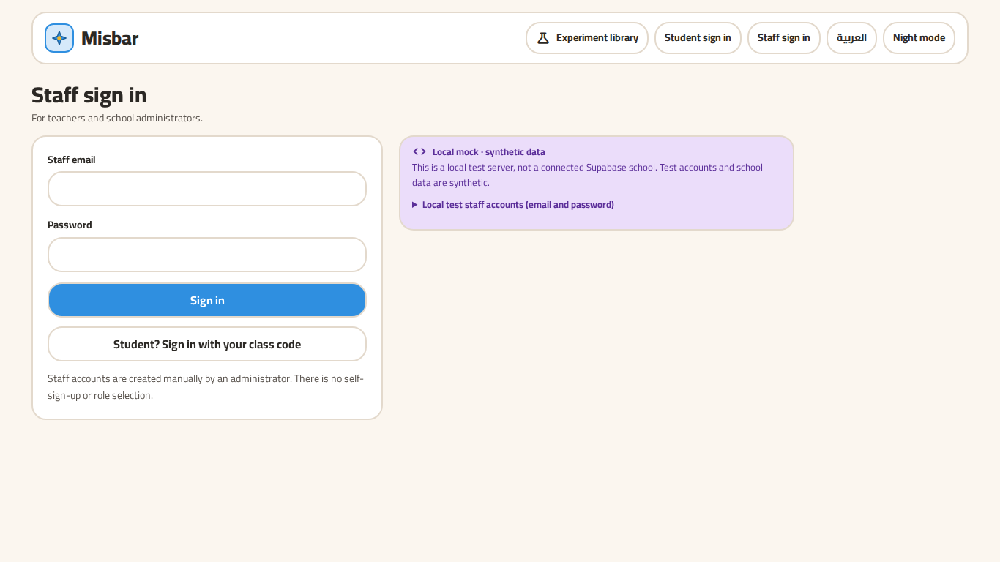
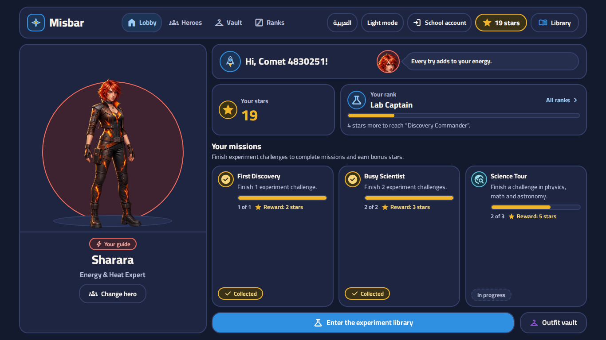
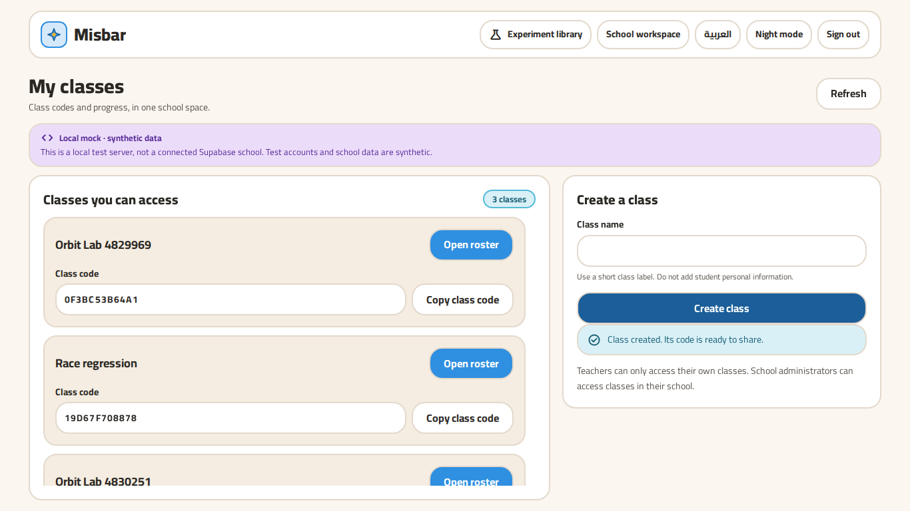
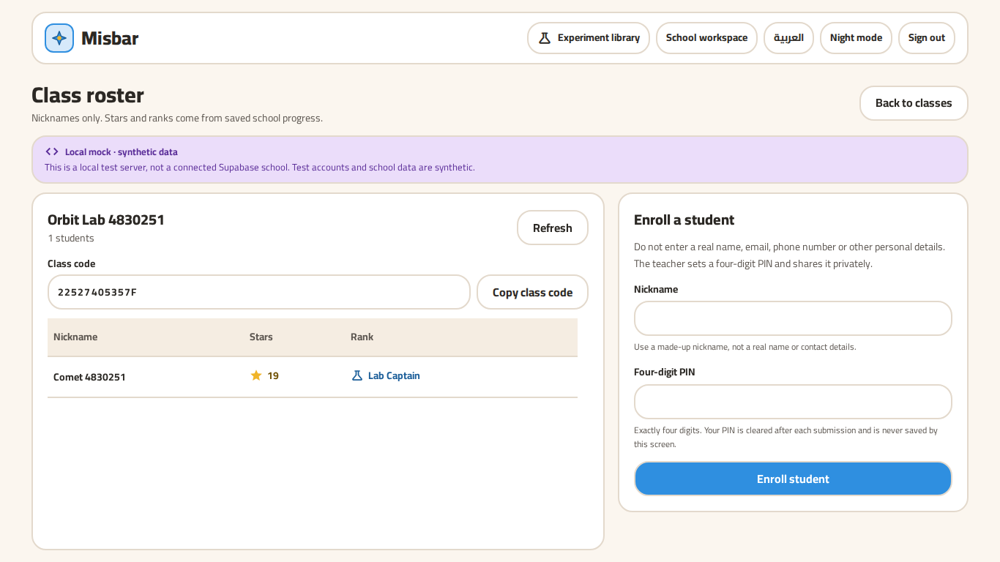
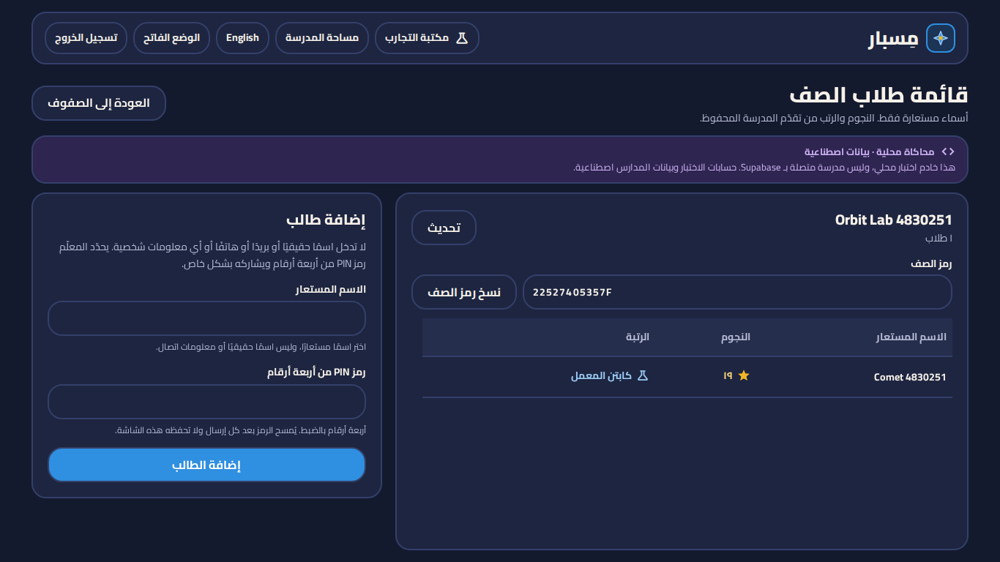
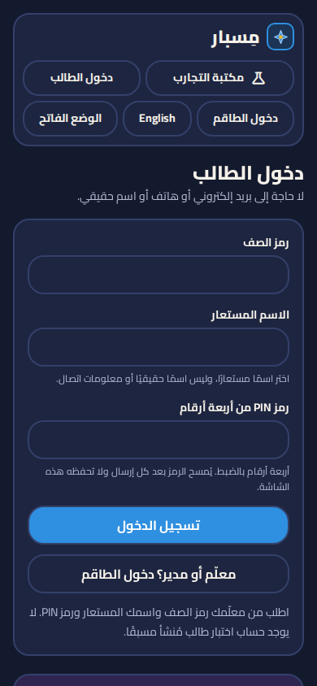

# Misbar — Phase 5A foundation final report

Completed: 2026-11-16 14:01 EET. Branch: **saas-foundation**. The latest attached seven-step guidance governs this delivery; the initial subscription-management/gate request was superseded.

**The mock foundation is complete and verified. Real Supabase Auth/RLS/PostgREST is NOT verified because credentials were not supplied.** No subscription gate, capacity enforcement, payment, parent-account feature or analytics dashboard is included. The subscriptions table and RLS remain schema-only. No publication or main merge was performed in this run.

## 1. Verified / NOT verified

| Check | Result | Actual evidence |
|---|---|---|
| Fresh GitHub branch clone and pinned install | Verified | pnpm11.25.0 install --frozen-lockfile passed in a separate clone; production build passed. |
| Final production source | Verified | `25feb9b9f14b06064f0e75cec0640167c160364e` built and served with explicit demonstration-only local mock. |
| Backend/auth/data tests | Verified — mock and transport fixtures | 27/27 tests, zero failures/skips, rerun from the clean clone. Supabase request assertions use injected responses, not a remote project. |
| Local migration/RLS proof | Verified — local PostgreSQL only | 148 PASS checks: 142 SQL assertions plus6 regression groups, exit0; synthetic transaction rolled back. |
| Real Supabase schema deployment/RLS/Auth/PostgREST | **NOT verified / NOT run** | SUPABASE_URL and SUPABASE_ANON_KEY absent. No live school database was created or changed. |
| Existing guest screens and progress | Verified | 192/192 guest viewport/language/theme cases; zero page/console errors, warnings or failed requests. Genuine UI-earned12→13→15→16→19 flow, rank changes and outfit unlock passed. |
| School screens | Verified — production mock | 80/80 cases: Arabic/English × light/night ×1366,1920,768,390,320px for login/classes/roster; no horizontal overflow, desktop fit, >=44px controls. No page/console errors or warnings. |
| Full school flow | Verified — production mock | 8 stages: guest15, create class/code, enroll alias/PIN, import15 once, earn19 on server, teacher roster19/rank, re-login19, guest still15. Uses the actual logout button. |
| Auth lifecycle timing | Verified — deliberate delayed-response tests | 4/4: pending restoration blocks guest writes; late401 cannot clear newer login; delayed logout cannot clear/reroute newer login; stale child action cannot hydrate a re-login with the same mock userId. |
| Original science rules/assets/dependencies | Verified | No diff from branch base in src/simulations, src/config/game.js, src/data/heroes.js, public/heroes, assets-src/heroes or pnpm-lock.yaml; no new app dependencies. |
| Public site version/publication | **NOT verified / not performed** | This is branch-only foundation work. The existing public site was not republished in this run. |

Evidence files: [clean clone](./clean-clone-verification.json), [backend TAP](./fresh-server-tests.tap), [guest matrix](./qa-guest-matrix.json), [school matrix](./qa-school-matrix.json), [guest reward flow](./qa-guest-flow.json), [school flow](./qa-school-flow.json), [auth timing](./qa-auth-races.json), [full local RLS output](./rls-local-proof.txt), [local RLS summary](./rls-local-summary.txt).

## 2. Commit checkpoints and branch discipline

| Step | Commit(s) | What was saved |
|---|---|---|
| 1. Baseline and status | ce2b317 | Baseline install/build, seven-step scope and phone-readable STATUS. |
| 2. Tenant schema | db7eb02,302ddfe | Additive migration, experiment_progress.stars, pseudonym constraints and safe privileges. |
| 3. RLS proof | 302ddfe | Executable isolated proof and logs; real Supabase explicitly NOT run. |
| 4. Auth/server | 4d21887 | Hashed PIN, rate limits, tenant/role authorization, labeled mock and Supabase transport. |
| 5. Adapters/import | ada4373,46de107 | Guest/server adapters, once-only import and generation-scoped auth/logout/queues. |
| 6. School screens | f20e705 | Bilingual/theme-aware logins, classes/code, enrollment and roster. |
| 7. Final QA | db9acb0237545d682dfb89186b8836ab3706f47b | Final production acceptance and screenshot/report evidence. |
| Additional clean-build/icon fixes | 9757543,25feb9b | Clean-clone verification and missing login glyph in the existing icon subset. |

Branch was created from main **e1bad49e71921b816ba92027796f3585aeb1fa6c**. A final read-only GitHub check found main had separately advanced to **873c991d12f5c380bf381f924e023deda48587c3**; this run did not push, merge or force-push main and did not rebase the foundation branch onto that separately advanced version. Inspect the current main before any future owner-authorized merge. STATUS updates and work commits were pushed to saas-foundation throughout.

## 3. Database and privacy foundation

The forward migration starts from the existing supabase/schema.sql and adds schools, school-bound profiles/classes, students, experiment_progress and subscriptions. Student rows contain only pseudonymous nickname, server PIN hash, tenant/class/Auth binding IDs and game progress—no email, legal-name, phone or photo columns. The inherited profiles.display_name is left NULL for child identities; no child name/photo collection UI exists.

Experiment progress stores the canonical experiment ID, completion timestamp and one-star reward. Guest game rules and the six scientific simulations are unchanged. Subscriptions are schema-only: no billing status gate or capacity enforcement is active.



The image is a **rendered extract of actual local SQL output**, not a Supabase-console screenshot. It shows the live local RLS flags and recorded assertions; real Supabase remains NOT run.

## 4. RLS proof: scope and result

RLS is enabled on all seven public application/scaffold tables, including the legacy events table, plus the private PIN-attempt table. Old anonymous events ingestion is closed. Teacher access is own-class only; school_admin is own-tenant only; a child gets its own row/progress through its bound anonymous Auth identity. Platform admins have only a global counts RPC and cannot read child/tenant table rows; there is no platform dashboard.

Clients cannot select pin_hash or SELECT * from students, cannot self-assign a role, and cannot pass another student ID to a progress action. Private JSON/hash helpers have default execute privileges revoked. Privileged functions pin search_path and derive the caller from signed top-level Auth claims, not user_metadata. Composite foreign keys prevent mismatched school/class/teacher assignments.

Executed locally:

```sh
bash supabase/tests/run-rls-proof.sh --reset-local-test-db
```

**148 PASS, zero ERROR/FAIL, exit0.** Proof includes schoolA denial of schoolB reads/writes; another teacher's class/student denial; child-only access; revoked prior child binding; admin counts-only access; persisted PIN failure counters across committed requests; duplicate-award concurrency; explicit per-experiment stars; and direct-RPC email/phone/URL/control-alias rejection. The main synthetic fixture rolled back.

The runner/bootstrap are **local test scaffolding only** and must never be run on a real Supabase database. Local auth/JWT stubs and non-bypass SQL client roles are not genuine GoTrue/PostgREST verification. The SQL assertion body is at supabase/tests/rls-proof.sql. Remote testing requires a separately prepared nonproduction Supabase project and actual Auth identities; it was NOT done here.

## 5. Authentication and data access

Teachers/admins use Supabase email/password transport in real mode. In this run, trusted synthetic staff accounts exercise the same HTTP interface. A child logs in with class code + nickname + four-digit PIN; Arabic/Persian digits entered in the UI normalize to ASCII before server verification. Secrets are cleared from form inputs immediately and are never placed in browser persistence, URLs or logs.

PIN hashes are generated server-side: asynchronous salted scrypt in the mock and bcrypt cost12 in the SQL RPC. Account-key failed attempts persist; the fifth bad attempt returns rate_limited and the15-minute window blocks further attempts. The HTTP peer limiter is additional protection, not a replacement for DB throttling. Child login uses email-free/phone-free anonymous Supabase Auth and is bound only after correct PIN verification.





src/lib/data-access.js is the small shared adapter module. Guests retain the original localStorage key/reducer; school progress is server-canonical and never saved into that guest key. The read/import/apply interface selects local guest persistence or the Supabase/mock HTTP transport. Arbitrary server snapshots/addStars are not accepted. First import is serialized, bounded to28 stars and validated IDs, and is once per child; subsequent login/import cannot reset canonical progress or its one-time markers.

Logout removes local credentials immediately and revokes only the captured token. Restoring a stored credential cannot silently mutate guest progress. Async actions/results are scoped to the login generation and captured token, including same-user re-login. The import was already assigned to the action queue; final review added stronger generation/token isolation rather than claiming that existing assignment was absent.



This screenshot shows the actual mock child at19 stars and Lab Captain. The accompanying flow JSON proves the separate guest remained15 and first import/re-login behavior was once-only; the screenshot alone is not the proof of guest storage isolation.

## 6. School workflow and viewport behavior

Teacher login → create a named class → receive/copy its random join code → enroll a made-up nickname/PIN → child login → earn experiment/mission stars → teacher roster shows canonical stars/rank. Enrollment collects no contact details or photo. Nickname syntax is enforced in both HTTP and DB/RPC; it cannot detect whether a valid-looking alias is actually a real name, so staff must choose pseudonyms.





Arabic/English and light/night use the existing Cairo/plain-CSS design tokens. Desktop layouts fit the viewport; long lists/rosters scroll internally. Phone/tablet layouts retain readable natural vertical flow, no horizontal overflow and44px controls. Existing guest headers have a school-account link; the inherited scientific experiments/game screens were not redesigned.





## 7. What the owner must set, and remaining limitations

Read [SUPABASE-SETUP.md](./SUPABASE-SETUP.md) for exact private environment, safe one-time migration order, manually provisioned staff UUIDs, anonymous Auth and real pilot checks. Set **SUPABASE_URL** and **SUPABASE_ANON_KEY** in ignored .env, with no VITE_ prefix. Both must be real nonempty values; omitted values select the labeled mock, while blank/partial configuration fails closed. No service-role key is required by the server.

The setup includes trusted-owner school/staff SQL, not a new public management endpoint. Existing unsupported legacy profile roles or populated unassigned legacy classes deliberately abort the migration until explicitly mapped/resolved. Never rerun the old scaffold after the forward migration: it restores an obsolete anonymous events policy.

Real Supabase schema deployment/Auth/RLS/PostgREST, actual-email delivery, production reverse-proxy abuse settings/backups and the public site are NOT verified. Mock storage and credentials are synthetic and unsuitable for a school production database. Supabase tokens require re-login after expiry; refresh/password-reset/class PIN-reset UI is not delivered. Anonymous Auth identity cleanup and deployment-specific abuse/CAPTCHA settings need real-project owner setup. Browser progress import is a bounded legacy compatibility concession, not an attestation of scientific work; canonical allowed challenge IDs/idempotence are checked server-side, but the server does not prove the child performed the visual experiment.

No subscription gate, student-limit enforcement, online payments, parent accounts or analytics were added in this run. Code changes are on saas-foundation only; main/public publication was not performed.
